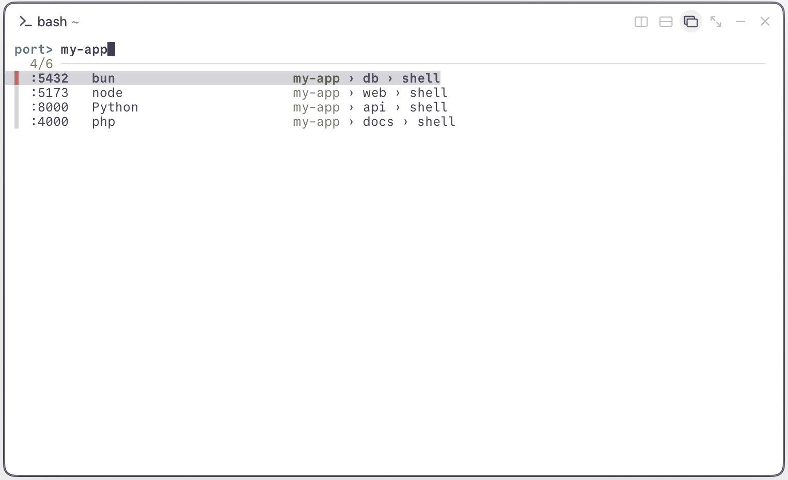

# rex-ports

A [Rex](https://www.superlogical.com/rex) plugin that finds which pane is running the server on a given port and jumps to it. It looks at every session, so you can find the process on `:5173` without remembering which tab started it.



## Requirements

- Rex, tested with 0.1.0-preview.19
- the `rex` CLI on your `PATH`, because the picker calls `rex do ports` to jump
- [fzf](https://github.com/junegunn/fzf)
- `lsof` and `ps`, which macOS ships with

## Install

Clone the repo into your Rex config folder:

```sh
git clone https://github.com/astwys/rex-ports ~/.config/rex/rex-ports
```

Load it from `~/.config/rex/init.lua` and bind a key to the `ports` action:

```lua
require("rex-ports")
rex.bind("ctrl+a>o", "ports")
```

Then run `rex config reload`.

## Usage

Press the key, or pick "Go to Port…" in the command palette. A floating pane lists each port that a process in a Rex pane listens on, with the process name and where the pane lives as `session › window › pane`. Enter jumps to the pane. Esc closes the picker.

To skip the picker, pass the port:

```sh
rex do ports port=5173
```

## How it works

`lsof` lists the listening TCP sockets and their process IDs. The plugin asks each Rex terminal for the PID of its shell, then walks each listener's parent processes until it reaches one of those shells. A listener that reaches none is left out.

Ports that Docker or OrbStack publish belong to the VM process, not to a pane, so they never appear.

## License

MIT
